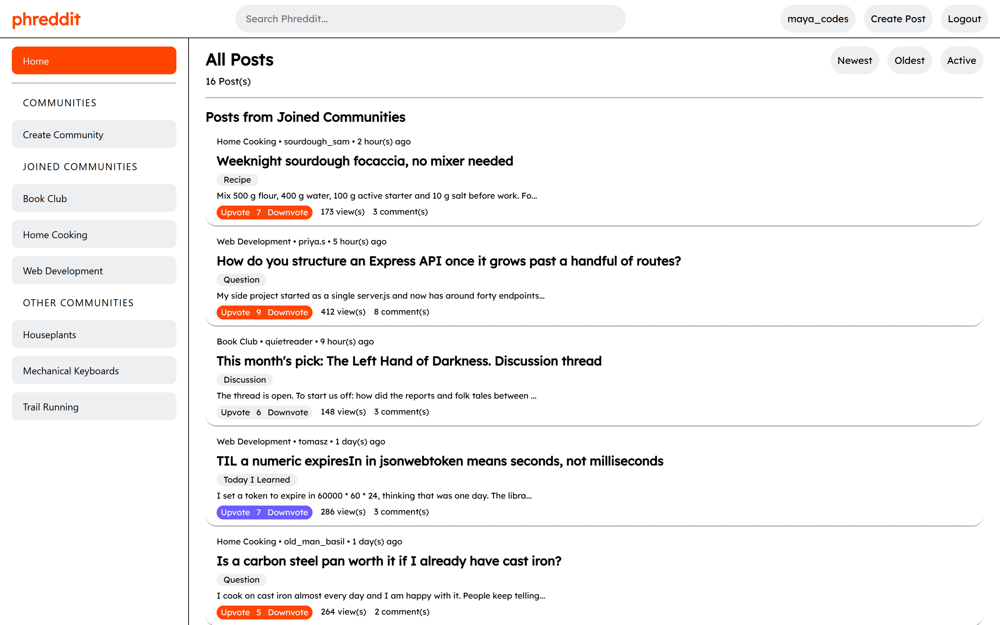
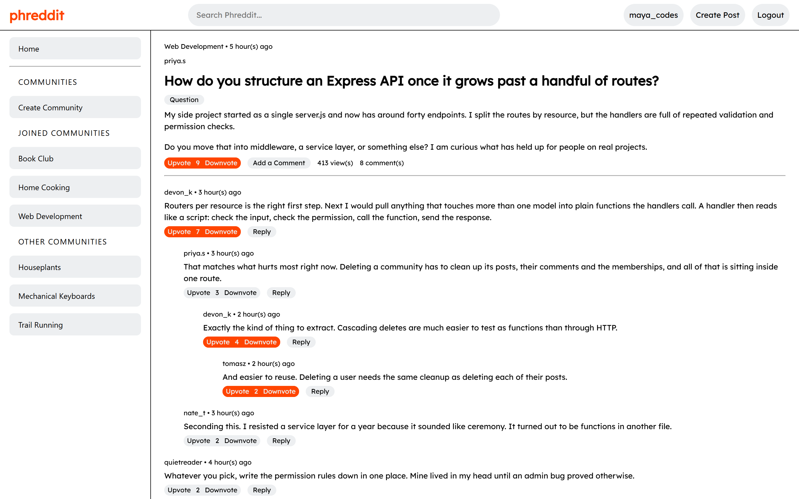
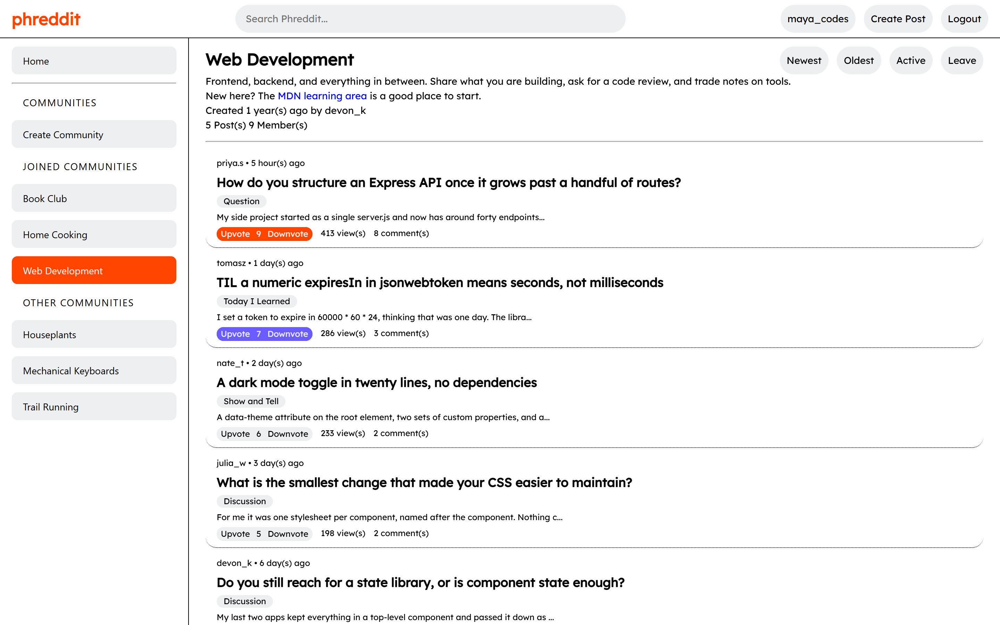
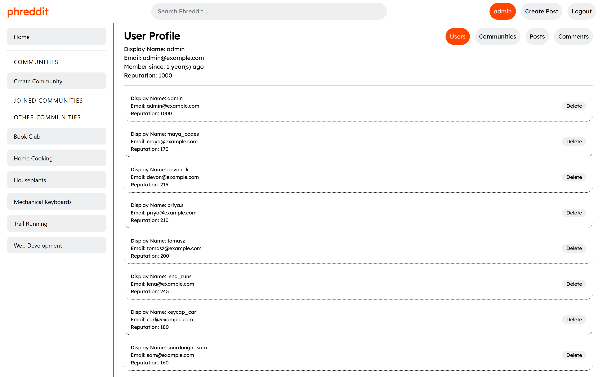

# Phreddit

Phreddit is a full-stack Reddit clone: a React single-page client, a Node.js and Express REST API, and MongoDB accessed through Mongoose. This README covers what the app does, how it is built, and how to run it locally.



- [Features](#features)
- [Screenshots](#screenshots)
- [Tech stack](#tech-stack)
- [Architecture](#architecture)
  - [Client](#client)
  - [Server](#server)
  - [Data models](#data-models)
  - [Authentication and permissions](#authentication-and-permissions)
- [API](#api)
  - [Users](#users)
  - [Communities](#communities)
  - [Posts](#posts)
  - [Comments](#comments)
  - [Link flairs](#link-flairs)
- [Diagrams](#diagrams)
  - [Class diagram](#class-diagram)
  - [Sequence diagram](#sequence-diagram)
  - [State diagram](#state-diagram)
- [Getting started](#getting-started)
  - [Prerequisites](#prerequisites)
  - [Install](#install)
  - [Configure](#configure)
  - [Seed the database](#seed-the-database)
  - [Run](#run)
  - [Test](#test)
- [Project structure](#project-structure)
- [License](#license)

## Features

- **Accounts.** Register, log in and log out. Guests can browse and search without an account.
- **Communities.** Create, join, leave, edit and delete communities. The creator becomes the owner and the first member.
- **Posts.** Each post belongs to a community, can carry a link flair chosen from the existing ones or created with the post, and counts its views.
- **Nested comments.** Reply to a post or to any comment. Threads nest to any depth.
- **Voting.** Upvote or downvote posts and comments. Voting the same way again removes the vote, and voting the other way switches it.
- **Reputation.** Every user starts at 100. An upvote gives the author 5, and a downvote takes 10. Users below 50 cannot vote.
- **Search.** A search finds the posts where any word of the query appears, ignoring case, in the title, the text, or any comment in the thread.
- **Sorting.** The home feed, community pages and search results sort by newest, oldest, or active. Active puts the post with the most recent comment first.
- **Personal feeds.** Logged-in users see posts from the communities they joined ahead of posts from other communities.
- **Links in text.** `[text](https://example.com)` in a post, comment or community description renders as a link.
- **User profiles.** A profile shows the user's display name, email, join date and reputation, and lists the communities they created, their posts and their comments, each of which they can edit or delete.
- **Admin role.** An admin can list every user, open any user's profile, edit or delete any community, post or comment, and delete users.
- **Cascading deletes.** Deleting a comment removes its replies. Deleting a post removes its comment thread. Deleting a community removes its posts. Deleting a user removes the communities they own, their posts and their comments.
- **Validation on both sides.** Forms are checked in the client, and the API checks the same input again before saving.

## Screenshots

The screenshots show the app running locally with the content the seed script creates.

A post with its comment thread. Replies nest under the comment they answer, and the votes of the logged-in user are highlighted.



A community page, with its description, creator, post and member counts, sort buttons, and the button to leave it.



The admin's profile, which lists every user with their reputation and a delete button.



## Tech stack

- **Client:** React, axios, and react-scripts for the development server and build.
- **Server:** Node.js, Express, Mongoose, jsonwebtoken, bcryptjs, cookie-parser and cors.
- **Database:** MongoDB.
- **Tooling:** Jest, React Testing Library, ESLint and nodemon.

## Architecture

### Client

The client is a single-page React app with no router library. The `Phreddit` component holds the top-level state: the current view, the posts and community on screen, the search query, the logged-in user, and the flash message. `Main` renders one page view at a time according to the view constants in `client/src/display.js`.

Components are grouped by role under `client/src/components`: `layout` holds the page frame (banner, navbar, flash message, main area), `pageviews` holds one component per screen, and `parts` holds the pieces the screens share, such as posts, comments, vote buttons and the page header. Every request goes through the axios instance in `client/src/api.js`, which sets the API base URL and sends the login cookie.

### Server

`server/server.js` connects to MongoDB, sets up CORS, cookie parsing and JSON parsing, and mounts one Express router per resource from `server/routes`. `server/util.js` holds what the routers share: the authentication middleware, the sort orders, the search, and the cascading delete helpers. `server/models` holds the Mongoose schemas, which validate lengths, required fields, email format and link syntax.

### Data models

| Model       | Fields                                                                                                                    | References                                                                                               |
| ----------- | ------------------------------------------------------------------------------------------------------------------------- | -------------------------------------------------------------------------------------------------------- |
| `User`      | `firstName`, `lastName`, `email` (unique), `displayName` (unique), `passwordHash`, `memberSince`, `reputation`, `isAdmin` | Joined communities, own posts, own comments, upvoted and downvoted posts, upvoted and downvoted comments |
| `Community` | `name` (unique), `description`, `startDate`, virtual `memberCount`                                                        | Owner, members, posts                                                                                    |
| `Post`      | `title`, `content`, `postedDate`, `views`, `voteCount`                                                                    | Community, author, optional link flair, top-level comments                                               |
| `Comment`   | `content`, `commentedDate`, `voteCount`                                                                                   | Post, author, replies                                                                                    |
| `LinkFlair` | `content`                                                                                                                 | None                                                                                                     |

A comment's replies are comments themselves, which is what lets a thread nest to any depth.

### Authentication and permissions

- **Passwords.** Passwords are hashed with bcrypt (the bcryptjs library) before they are stored, and the hash is left out of every API response.
- **Sessions.** Logging in signs a JSON Web Token carrying the user's id and sets it in an HTTP-only, `SameSite=Lax` cookie. The token and the cookie both expire after one day.
- **Secret.** The token is signed with `JWT_SECRET`, which the server reads from the environment and refuses to start without.
- **Middleware.** `authenticate` rejects a request without a valid token with a 401. `attachUserIfAuthenticated` lets guests through and attaches the user when there is one.
- **Admin checks.** Only an admin can list all users or delete a user.
- **Owner checks.** Only a community's owner or an admin can edit or delete it.
- **Author checks.** Only the author of a post or comment, or an admin, can edit or delete it.
- **Profile checks.** A user's record is returned only to that user or an admin.
- **Reputation check.** Voting requires a reputation of at least 50.

## API

All paths are relative to the server root, `http://localhost:8000` by default. In the Access column, "Optional" means the endpoint works for guests and returns more for a logged-in user, and "Login" means it needs the login cookie.

### Users

| Method | Path              | Access        | Purpose                                                  |
| ------ | ----------------- | ------------- | -------------------------------------------------------- |
| POST   | `/users/register` | Public        | Create an account                                        |
| POST   | `/users/login`    | Public        | Check the credentials and set the login cookie           |
| GET    | `/users/logout`   | Public        | Clear the login cookie                                   |
| GET    | `/users/loggedIn` | Optional      | Return the logged-in user, if there is one               |
| GET    | `/users/info`     | Login         | Return the logged-in user                                |
| GET    | `/users`          | Admin         | List every user                                          |
| GET    | `/users/:userId`  | Self or admin | Return one user                                          |
| DELETE | `/users/:userId`  | Admin         | Delete a user with their communities, posts and comments |

### Communities

| Method | Path                                     | Access         | Purpose                                                                    |
| ------ | ---------------------------------------- | -------------- | -------------------------------------------------------------------------- |
| GET    | `/communities`                           | Optional       | List communities by name, split into joined and other for a logged-in user |
| GET    | `/communities/:communityId`              | Public         | Return one community                                                       |
| GET    | `/communities/:communityId/posts/newest` | Public         | List the community's posts, newest first                                   |
| GET    | `/communities/:communityId/posts/oldest` | Public         | List the community's posts, oldest first                                   |
| GET    | `/communities/:communityId/posts/active` | Public         | List the community's posts, most recently commented first                  |
| POST   | `/communities`                           | Login          | Create a community owned by the logged-in user                             |
| PUT    | `/communities/:communityId/join`         | Login          | Join a community                                                           |
| PUT    | `/communities/:communityId/leave`        | Login          | Leave a community                                                          |
| PUT    | `/communities/:communityId/edit`         | Owner or admin | Change a community's name and description                                  |
| DELETE | `/communities/:communityId`              | Owner or admin | Delete a community with its posts and their comments                       |

### Posts

| Method | Path                      | Access                | Purpose                                                                |
| ------ | ------------------------- | --------------------- | ---------------------------------------------------------------------- |
| POST   | `/posts`                  | Login                 | Create a post in a community                                           |
| GET    | `/posts/newest`           | Optional              | List all posts, newest first                                           |
| GET    | `/posts/oldest`           | Optional              | List all posts, oldest first                                           |
| GET    | `/posts/active`           | Optional              | List all posts, most recently commented first                          |
| GET    | `/posts/search/newest`    | Optional              | Search posts with the `query` parameter, newest first                  |
| GET    | `/posts/search/oldest`    | Optional              | Search posts with the `query` parameter, oldest first                  |
| GET    | `/posts/search/active`    | Optional              | Search posts with the `query` parameter, most recently commented first |
| GET    | `/posts/:postId`          | Public                | Return one post with its whole comment thread                          |
| PUT    | `/posts/:postId/views`    | Public                | Add one to the post's view count                                       |
| PUT    | `/posts/:postId/upvote`   | Login, reputation 50+ | Add, remove or switch to an upvote                                     |
| PUT    | `/posts/:postId/downvote` | Login, reputation 50+ | Add, remove or switch to a downvote                                    |
| PUT    | `/posts/:postId/edit`     | Author or admin       | Change a post's title, text, link flair or community                   |
| DELETE | `/posts/:postId`          | Author or admin       | Delete a post with its comment thread                                  |

For a logged-in user, the list and search endpoints also return the posts split into those from joined communities and those from other communities.

### Comments

| Method | Path                            | Access                | Purpose                                       |
| ------ | ------------------------------- | --------------------- | --------------------------------------------- |
| POST   | `/comments`                     | Login                 | Comment on a post or reply to a comment       |
| GET    | `/comments/:commentId`          | Public                | Return one comment with the title of its post |
| PUT    | `/comments/:commentId/upvote`   | Login, reputation 50+ | Add, remove or switch to an upvote            |
| PUT    | `/comments/:commentId/downvote` | Login, reputation 50+ | Add, remove or switch to a downvote           |
| PUT    | `/comments/:commentId/edit`     | Author or admin       | Change a comment's text                       |
| DELETE | `/comments/:commentId`          | Author or admin       | Delete a comment with its replies             |

### Link flairs

| Method | Path          | Access | Purpose                             |
| ------ | ------------- | ------ | ----------------------------------- |
| GET    | `/linkflairs` | Public | List the link flairs alphabetically |
| POST   | `/linkflairs` | Login  | Create a link flair                 |

## Diagrams

The diagrams are in `images`. The sequence and state diagrams are PlantUML, each with its `.txt` source next to the rendered image.

### Class diagram

The five Mongoose models, their fields, and the references between them.


### Sequence diagram

What happens when a user opens a post from a listing: the client asks the server to count the view, then fetches the post.


### State diagram

How the client moves between its page views.


## Getting started

### Prerequisites

- Node.js 20.12 or later. The server loads `server/.env` with `process.loadEnvFile`, which older versions do not have.
- npm, which is installed with Node.js.
- MongoDB Community Server, running locally on its default port, 27017.

### Install

Clone the repository and install the dependencies of the server and the client.

```sh
git clone https://github.com/cloudfluffy/phreddit.git
cd phreddit
cd server && npm ci
cd ../client && npm ci
cd ..
```

### Configure

The server needs a secret to sign login tokens. Copy the example file and replace the placeholder with a long random string.

```sh
cp server/.env.example server/.env
node -e "console.log(require('crypto').randomBytes(48).toString('hex'))"
```

The second command prints a suitable value. `server/.env` is ignored by git.

| Variable            | Set it in                                 | Required | Purpose                                                                            |
| ------------------- | ----------------------------------------- | -------- | ---------------------------------------------------------------------------------- |
| `JWT_SECRET`        | `server/.env` or the server's environment | Yes      | Signs and verifies login tokens. The server exits with an error without it.        |
| `PORT`              | `server/.env` or the server's environment | No       | Port the server listens on. Defaults to `8000`.                                    |
| `MONGODB_URL`       | `server/.env` or the server's environment | No       | Database the server connects to. Defaults to `mongodb://127.0.0.1:27017/phreddit`. |
| `CLIENT_ORIGIN`     | `server/.env` or the server's environment | No       | Browser origin allowed to call the API. Defaults to `http://localhost:3000`.       |
| `REACT_APP_API_URL` | `client/.env` or the client's environment | No       | Base URL the client sends API requests to. Defaults to `http://localhost:8000`.    |

A variable set in the environment takes precedence over the same variable in a `.env` file. The client reads `REACT_APP_API_URL` when it starts or builds, so restart it after a change.

### Seed the database

With MongoDB running, run the seed script from the repository root. It takes the MongoDB URL, then the email, display name and password of the admin account to create.

```sh
node server/init.js mongodb://127.0.0.1:27017/phreddit admin@example.com admin choose-a-password
```

The script empties the users, communities, posts, comments and link flairs collections of that database before it fills them. Besides the admin, it creates sample users, communities, posts, nested comments and votes, dated relative to the moment it runs.

The sample users all have the password `1234`. Log in as `maya@example.com` to see a member's view, with joined communities and votes already cast. Log in as `hal@example.com` to see the reputation rule: that user's comments were downvoted below 50, so voting is refused.

### Run

Start the server from one terminal. It listens on port 8000.

```sh
cd server
npm run dev
```

`npm run dev` restarts the server when a file changes. `npm start` runs it without watching.

Start the client from a second terminal, then open `http://localhost:3000`.

```sh
cd client
npm start
```

### Test

The test suites are small.

The server tests need MongoDB and the server running with the default port and database, and they use the `phreddit` database.

```sh
cd server
npm test
```

- `express.test.js` checks that the server answers `GET /users/loggedIn` on port 8000.
- `mongoDB.test.js` creates an admin, a community, a post and a nested comment thread, then deletes the post, the community and the admin through the API and checks that the records are gone.

The client tests need nothing running.

```sh
cd client
npm test
```

- `react.test.js` renders the banner and checks that the Create Post button is disabled for a guest and enabled for a logged-in user.

## Project structure

```text
phreddit/
  client/
    public/               HTML template, web app manifest and icons
    src/
      api.js              Shared axios instance and API base URL
      display.js          Constants naming each page view
      listing.js          Constants naming each profile listing
      components/
        layout/           Page frame: banner, navbar, flash message, main area
        pageviews/        One component per screen
        parts/            Pieces shared between screens
      stylesheets/        CSS, in folders that mirror components/
      util/               Timestamp, comment count, link parsing and error helpers
    react.test.js         Client tests
  server/
    server.js             Entry point: database connection, middleware, routers
    environment.js        Loads and checks JWT_SECRET
    init.js               Database seed script
    util.js               Auth middleware, sorting, search, cascading deletes
    models/               Mongoose schemas
    routes/               One Express router per resource
    express.test.js       Server test
    mongoDB.test.js       Server test
    .env.example          Template for server/.env
  images/                 UML diagrams and their sources
    screenshots/          Screenshots used in this README
```

## License

Phreddit is released under the MIT License. See [LICENSE](LICENSE).
